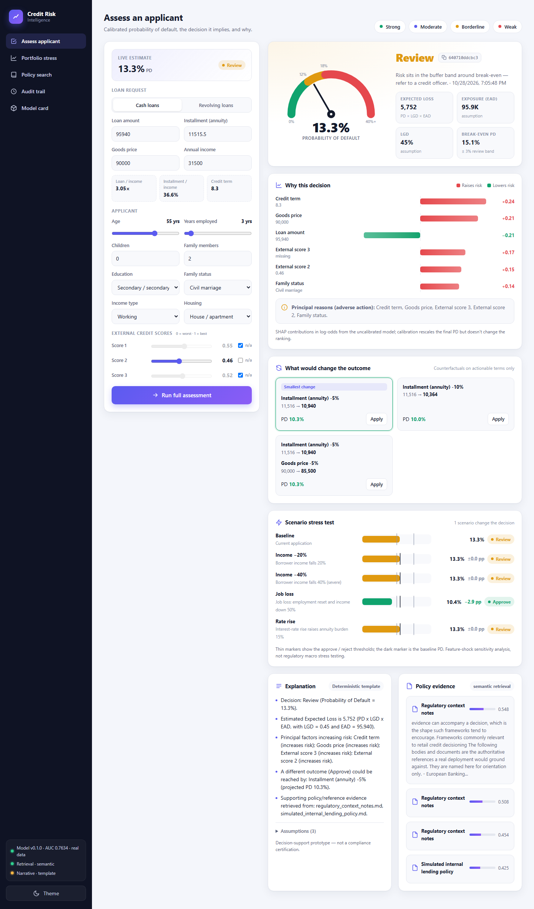
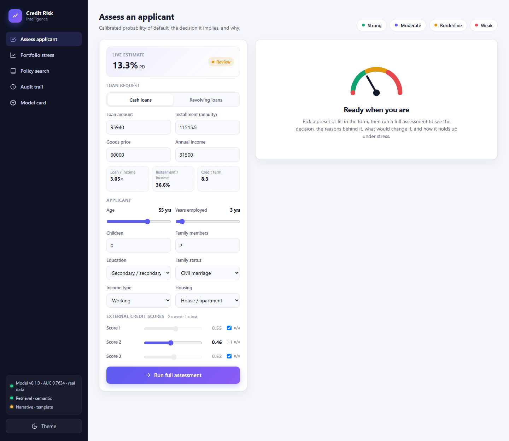
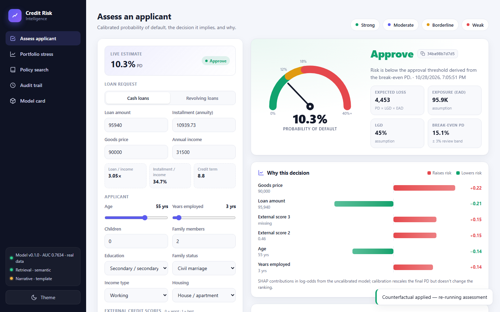
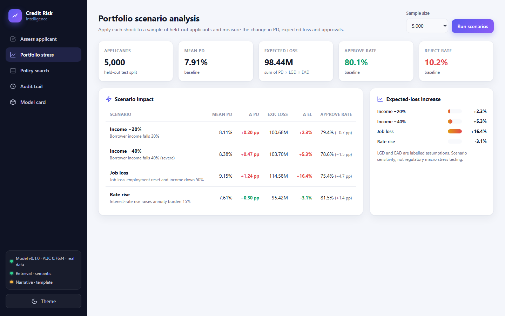
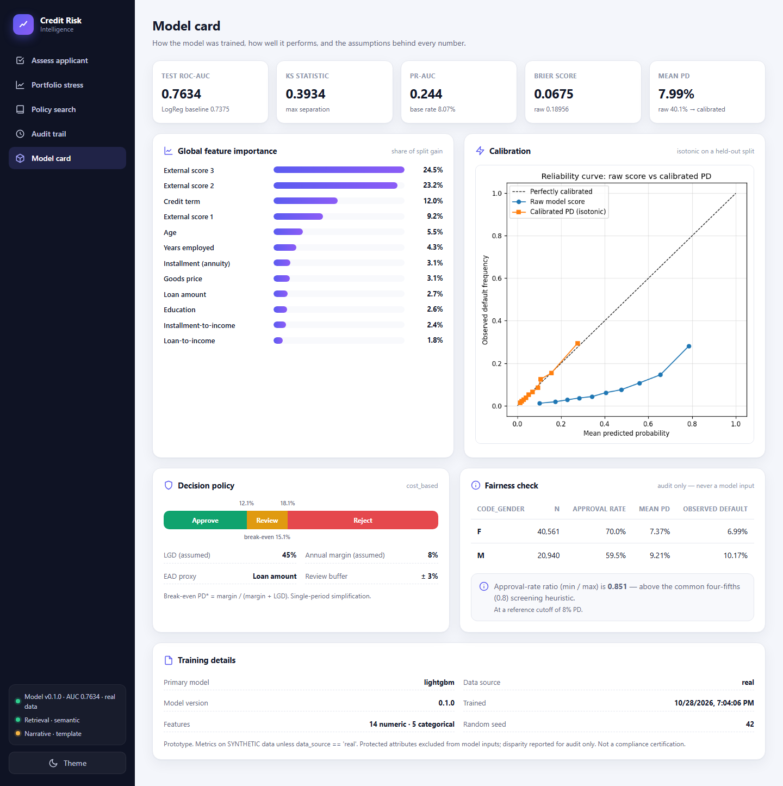

# CreditLens

**Explainable Credit Risk Decisioning with Calibrated PD, SHAP, and Regulation-Grounded RAG**



| Test ROC-AUC | Brier (raw → calibrated) | Defaulters caught in 20% flagged | Counterfactual coverage | Latency (p50) |
|---|---|---|---|---|
| **0.763** | 0.190 → **0.068** | **54%** | **84%** of flagged | **~50 ms** |

<sub>Measured on the 61,503-applicant held-out test split of Home Credit Default Risk.</sub>

A **local-first, regulation-grounded credit decision-support prototype**. It
trains a credit-risk model, turns a calibrated Probability of Default into an
Approve / Review / Reject decision, explains that decision, suggests how a
decline could be reversed, quantifies expected loss, stress-tests it, grounds it
in retrieved policy evidence, and records everything in an audit trail.

> **This is a prototype, not a compliance-certified system.** It does not claim
> to meet any regulatory requirement. All loss-given-default and
> exposure-at-default figures are **labelled assumptions**. See *Limitations*.

Ships with a **built-in web UI** (served by the API, no build step, works
offline) and a REST API that any other frontend can call.

## Quick start

```bash
# Windows: double-click start.bat  (creates .venv, installs deps, builds, opens the UI)

# Any OS, from an activated virtualenv with requirements installed:
python scripts/serve.py
```

`serve.py` runs data prep, training and RAG ingestion **only if their
artifacts are missing**, then serves the UI at <http://127.0.0.1:8000> and the
API docs at <http://127.0.0.1:8000/docs>. Use `--rebuild` to force a full
retrain, `--port` to change the port, and `--no-browser` to skip opening a tab.

---

## What it does

1. **Credit-risk model** — Logistic Regression baseline + LightGBM primary on the
   Home Credit Default Risk dataset (main application table).
2. **Calibrated PD → decision** — raw model scores are calibrated to true
   probabilities, then mapped to Approve / Review / Reject using **cost-based**
   thresholds.
3. **Explainability** — SHAP attributions, presented as **adverse-action reason
   codes** (the specific factors behind a decision).
4. **Counterfactuals** — the smallest realistic change to *actionable* loan terms
   that would flip a decline; returns "not feasible" honestly when none exists.
5. **Risk metrics** — `Expected Loss = PD × LGD × EAD`, with assumptions labelled.
6. **Scenario sensitivity ("stress test")** — income drop, job loss, rate rise,
   on a single applicant and across a portfolio.
7. **RAG** — retrieves supporting evidence from a simulated internal policy and
   (if you add them) real EBA/ECB/BaFin documents.
8. **LLM (optional)** — phrases the already-computed results in plain language.
   It never invents a number, decision or regulatory claim.
9. **Audit trail** — every decision stored with model version, PD, decision,
   SHAP factors, counterfactuals, risk metrics, retrieved sources and narrative.
10. **Offline mode** — the entire core runs with no API key and no internet.
11. **Web UI** — interactive assessor, portfolio stress, policy search, audit
    trail and model card (see *Web UI* below).

---

## Architecture

```
            applicant (base fields)
                     │
                     ▼
        ┌────────────────────────┐
        │  Model  (LightGBM +     │   calibrated PD
        │  isotonic calibration)  │─────────────┐
        └────────────────────────┘             │
                     │                          ▼
        ┌────────────▼───────────┐   ┌──────────────────────┐
        │  Explainability (SHAP) │   │  Risk engine          │
        │  → reason codes        │   │  PD→decision (cost),  │
        └────────────┬───────────┘   │  EL = PD·LGD·EAD      │
                     │               └──────────┬───────────┘
        ┌────────────▼───────────┐              │
        │  Counterfactuals       │   ┌──────────▼───────────┐
        │  (actionable only)     │   │  Scenario sensitivity │
        └────────────┬───────────┘   └──────────┬───────────┘
                     │                          │
        ┌────────────▼──────────────────────────▼───────────┐
        │  Policy / RAG  (local embeddings + Qdrant)         │
        └────────────────────────┬───────────────────────────┘
                                 │  facts (all numbers fixed here)
        ┌────────────────────────▼───────────────────────────┐
        │  LLM explanation (optional) / deterministic template │
        └────────────────────────┬───────────────────────────┘
                                 ▼
                         Audit trail (SQLite)
                                 ▲
                      FastAPI endpoints (CORS)
```

Each stage is a separate module under `src/credit_risk/`. The LLM sits at the
end and only consumes facts produced upstream.

---

## Project structure

```
CreditLens/
├── config.yaml                 # all tunable parameters + labelled assumptions
├── requirements.txt
├── .env.example                # optional LLM keys only
├── README.md
├── start.bat                   # Windows one-click launcher
├── frontend/                   # web UI (index.html, styles.css, app.js)
├── scripts/
│   ├── serve.py                # build missing artifacts + serve UI and API
│   ├── prepare_data.py         # load + clean + split (real or synthetic)
│   ├── train_model.py          # LR + LightGBM + calibration + evaluation
│   ├── ingest_rag.py           # chunk + embed + index policy docs
│   └── run_demo.py             # full end-to-end demo on synthetic applicants
├── src/credit_risk/
│   ├── config.py               # config.yaml + .env loader
│   ├── features.py             # shared applicant feature engineering
│   ├── service.py              # orchestrator: predict→…→narrative→audit
│   ├── data/      (synthetic.py, prepare.py)
│   ├── model/     (preprocessing.py, train.py, evaluate.py, predict.py)
│   ├── risk/      (engine.py)
│   ├── explain/   (shap_explainer.py)
│   ├── counterfactual/ (engine.py)
│   ├── stress/    (engine.py)
│   ├── rag/       (embeddings.py, vector_store.py, ingest.py, query.py)
│   ├── llm/       (providers.py, explain.py)
│   ├── audit/     (store.py)
│   └── api/       (main.py, schemas.py)
├── docs/policy/                # simulated policy + context notes + SOURCES.md
├── data/{raw,processed}/       # gitignored
├── artifacts/                  # models, calibration plot, vector store, audit db
└── tests/                      # test_core.py (unit) + test_integration.py
```

---

## Installation

Requires **Python 3.10+** (developed on 3.12). No Docker.

```bash
git clone https://github.com/rahulpatil0512/CreditLens.git
cd CreditLens
python -m venv .venv
source .venv/bin/activate            # Windows: .venv\Scripts\activate
pip install -r requirements.txt
```

`sentence-transformers` is optional (semantic RAG); everything runs without it.

---

## Dataset setup

**Option A — real data (included).**
This repo ships the Kaggle **Home Credit Default Risk** `application_train.csv`
zipped at `data/raw/application_train.csv.zip` (38 MB; the raw CSV is 166 MB,
over GitHub's file limit). Data prep reads the zip directly, so nothing needs
extracting. An unzipped `data/raw/application_train.csv` takes precedence if
present. The dataset is © Home Credit Group, published via the
[Kaggle competition](https://www.kaggle.com/c/home-credit-default-risk) and
subject to its terms; it is included here for reproducibility only.

**Option B — synthetic (zero setup).**
If no file is present, a synthetic generator that mimics the Home Credit schema
is used automatically, so the whole pipeline runs offline. Synthetic results are
for pipeline validation only — never put synthetic metrics on a CV.

---

## Running it

```bash
# 1) prepare data (real if present, else synthetic)
python scripts/prepare_data.py

# 2) train baseline + model, calibrate PD, write artifacts + calibration plot
python scripts/train_model.py

# 3) ingest policy documents into the RAG index
python scripts/ingest_rag.py

# 4) full end-to-end demo (no manual input, works offline)
python scripts/run_demo.py

# 5) start the API + web UI
python scripts/serve.py
# or: python -m uvicorn credit_risk.api.main:app --app-dir src --port 8000
# UI at http://127.0.0.1:8000  ·  interactive API docs at http://127.0.0.1:8000/docs
```

Run the tests any time:

```bash
pytest -q
```

---

## Web UI

| Live estimate as you type | Counterfactual applied → Approve |
|---|---|
|  |  |
| **Portfolio stress (5,000 applicants)** | **Model card** |
|  |  |

Open <http://127.0.0.1:8000> once the server is running. Plain HTML/CSS/JS with
hand-drawn SVG charts and no CDN dependencies, so it works offline. Light and
dark themes, responsive down to phone width.

| Page | What it does |
|------|--------------|
| **Assess applicant** | Form with presets (Strong / Moderate / Borderline / Weak) and a **live PD estimate** that updates as you type. *Run full assessment* shows the PD gauge against the decision bands, expected loss, SHAP reason codes, counterfactuals (with **Apply** to re-run with the change), a scenario stress test, the narrative and the retrieved policy evidence. |
| **Portfolio stress** | Runs every scenario over 250–5,000 held-out applicants: mean PD, expected loss and approval rate deltas. |
| **Policy search** | Semantic (or lexical) retrieval over the policy documents. |
| **Audit trail** | Decision mix, recent decisions, and the full stored record for any audit ID. |
| **Model card** | Test metrics, global feature importance, calibration curve, decision policy, fairness check, training details. |

Every assessment gets a shareable URL: `http://127.0.0.1:8000/#assess/<audit_id>`
re-opens that stored decision in the assessor.

---

## API reference

Base URL `http://127.0.0.1:8000`. Interactive Swagger UI at `/docs`.

| Method | Path | Purpose |
|-------|------|---------|
| GET  | `/health` | liveness + model / RAG / LLM availability |
| GET  | `/meta/options` | category values the model knows (for dropdowns) |
| GET  | `/meta/demo-applicants` | bundled demo applicants |
| GET  | `/model/info` | model card: metrics, thresholds, importance, fairness |
| GET  | `/model/calibration-plot` | calibration curve PNG |
| POST | `/predict` | full assessment + audit (returns `audit_id`) |
| POST | `/explain` | SHAP reason codes (by `applicant` or `audit_id`) |
| POST | `/counterfactual` | actionable counterfactuals |
| POST | `/stress-test` | scenario sensitivity (applicant and/or portfolio) |
| POST | `/rag/query` | retrieve policy/regulatory evidence |
| GET  | `/audit?limit=25` | recent decisions + decision counts |
| GET  | `/audit/{id}` | fetch a stored decision record |
| GET  | `/` | web UI |

**Example — `/predict`:**

```bash
curl -s http://127.0.0.1:8000/predict -H "Content-Type: application/json" -d '{
  "applicant": {
    "AMT_INCOME_TOTAL": 150000, "AMT_CREDIT": 540000, "AMT_ANNUITY": 26000,
    "AMT_GOODS_PRICE": 540000, "AGE_YEARS": 35, "YEARS_EMPLOYED": 5,
    "EXT_SOURCE_1": 0.55, "EXT_SOURCE_2": 0.58, "EXT_SOURCE_3": 0.52,
    "CNT_CHILDREN": 1, "CNT_FAM_MEMBERS": 3,
    "NAME_CONTRACT_TYPE": "Cash loans", "NAME_EDUCATION_TYPE": "Higher education",
    "NAME_FAMILY_STATUS": "Married", "NAME_INCOME_TYPE": "Working",
    "NAME_HOUSING_TYPE": "House / apartment"
  }
}'
```

Returns PD, decision, risk metrics, SHAP factors, counterfactuals, RAG evidence,
narrative and an `audit_id`. The drill-down endpoints accept `{"audit_id": "..."}`
to re-run a single piece for a stored applicant.

**Example — `/stress-test` with a portfolio sweep:**

```bash
curl -s http://127.0.0.1:8000/stress-test -H "Content-Type: application/json" \
  -d '{"audit_id": "<id from /predict>", "portfolio_sample": 500}'
```

---

## Offline mode

The core — model, SHAP, counterfactuals, risk, stress — is pure local compute.
Two integrations have offline-safe fallbacks:

- **RAG embeddings.** Primary is a local `sentence-transformers` model
  (downloads once; afterwards it loads from the local cache without
  contacting Hugging Face). If it is not installed or there is no internet, the system
  falls back to a **zero-download lexical embedder** (scikit-learn hashing) so
  retrieval still works. Set `rag.prefer_semantic: false` in `config.yaml` to
  force lexical mode.
- **LLM explanation.** If disabled or no key is present, a **deterministic
  template** produces the explanation. The template is always the source of the
  facts; the LLM only rephrases it.

So: **no API key and no internet → the full system still runs.**

---

## Optional LLM phrasing

To have results phrased by an LLM, copy `.env.example` to `.env` and set the key
for your provider, then set `llm.enabled: true` and `llm.provider` in
`config.yaml` (`anthropic` | `openai` | `gemini` | `ollama`).

```bash
cp .env.example .env
# edit .env, e.g.  ANTHROPIC_API_KEY=sk-ant-...
pip install anthropic          # install only the SDK you use
```

The LLM is constrained by design: all numbers, decisions and factors are fixed
upstream; the model is told only to rephrase; and a guardrail discards any
output that drops the decision or claims compliance, falling back to the
template. **The LLM can never originate a PD, calculation, decision or
regulatory claim.**

---

## Design decisions & correctness notes

- **PD calibration is mandatory.** LightGBM with `class_weight=balanced` produces
  inflated scores (on the synthetic data, mean score ≈ 0.31 vs a true 0.08 base
  rate). Isotonic calibration on a held-out split corrects this; without it,
  Expected Loss and every threshold would be wrong. See
  `artifacts/calibration_curve.png`.
- **Cost-based thresholds.** Approve/Reject bands come from a break-even PD,
  `PD* = margin / (margin + LGD)`, with a review buffer — not arbitrary cutoffs.
  A `fixed` mode is available. This is a single-period simplification.
- **Fairness.** `CODE_GENDER` is excluded from model inputs and kept only for a
  post-hoc approval-rate disparity check (in `model_metadata.json`).
- **Counterfactual honesty.** Only actionable loan terms move, within realistic
  bounds; derived ratios are recomputed; if nothing flips the decision, the
  result says so rather than inventing one.
- **"Stress test" is scenario sensitivity analysis**, not regulatory macro stress
  testing (which needs a macro-to-default model this prototype does not have).
- **Labelled assumptions.** LGD (0.45) and EAD (≈ loan amount) are assumptions,
  surfaced in every result and the audit record.
- **Vector store concurrency.** Embedded Qdrant allows one process per storage
  folder. Ingestion also writes a small numpy mirror of the index, so while the
  API server holds Qdrant, tests and `run_demo.py` read the mirror instead of
  silently getting no evidence.
- **Rate-rise scenario.** The shock raises the installment, which lowers the
  derived `CREDIT_TERM`. On real Home Credit data shorter terms default less,
  so this scenario can *reduce* PD. That is the learned pattern, not a bug, and
  the UI says so; a proper rate shock needs a term-aware pricing model.

---

## Limitations

- Uses the main application table only; the Home Credit auxiliary tables are not
  joined (a deliberate scope choice — simpler and interpretable).
- LGD/EAD are assumptions; the dataset has no recovery/exposure outcomes.
- Scenario sensitivity ≠ regulatory stress testing.
- Not a compliance tool and not legal/financial advice.
- On the synthetic data the linear baseline can match or beat LightGBM because
  the synthetic signal is near-logistic; this does not generalise to real data.

---

## Future Lovable frontend integration

The API is CORS-enabled (`api.cors_origins` in `config.yaml`; `*` for local dev,
restrict in production). To connect a Lovable app:

1. Run the API locally (or deploy it) and note the base URL.
2. In Lovable, call the REST endpoints above (`/predict`, `/explain`,
   `/counterfactual`, `/stress-test`, `/rag/query`, `/audit/{id}`).
3. Suggested screens: applicant form → decision card (PD, decision, EL) →
   reason-codes panel → counterfactual "what would change this" → stress sliders
   → evidence drawer (RAG) → audit lookup by id.
4. Set `api.cors_origins` to your Lovable app's origin before deploying.

---

## Results on the real Home Credit data

Trained on `application_train.csv` (307,511 applications; 199,881 train /
46,127 calibration / 61,503 test, stratified, seed 42):

| Metric (test split) | Value |
|---|---|
| ROC-AUC (LightGBM) | **0.763** |
| ROC-AUC (Logistic Regression baseline) | 0.738 |
| KS statistic | 0.393 |
| PR-AUC (base rate 8.07%) | 0.244 |
| Brier score, raw → calibrated | 0.190 → **0.068** |
| Mean PD, raw → calibrated | 40.1% → **8.0%** (matches the 8.07% base rate) |
| Gender approval-rate ratio (min/max) | 0.85 |

Top drivers: external scores 3 and 2 (≈ 48% of split gain combined), credit
term, external score 1, age.

## For your CV

- Built a local-first credit decision-support system: calibrated PD
  (LightGBM + isotonic) driving cost-based Approve/Review/Reject, with
  `Expected Loss = PD×LGD×EAD`; achieved AUC 0.763 / KS 0.39 on the Home
  Credit test split, with calibrated probabilities (Brier 0.068).
- Added SHAP adverse-action reason codes, actionable counterfactuals, portfolio
  scenario stress testing, and a regulation-grounded RAG layer (local
  embeddings + Qdrant), exposed via a FastAPI service with a full audit trail
  and an interactive web UI.

Do not use the synthetic-data numbers in this repo on your CV.
```
